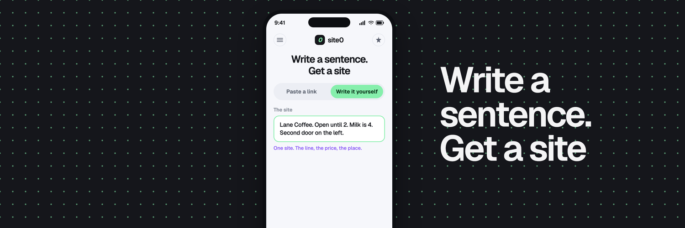

<p align="center">
  
</p>

<p align="center">
  
</p>

<h1 align="center">site0</h1>

<p align="center">
  Paste a page, or write one sentence.<br>
  Get a card you can send.
</p>

<p align="center">
  
</p>

## The card

A sentence becomes one screen. The name, the price, the hours, and the door stay as written. Nothing else gets invented.

```
Lane Coffee. Open until 2. Milk is 4. Second door on the left.
```

Paste a public link when you want that page open in the frame. Switch to writing when you want the card.

## Three steps

1. Paste a link, or write the sentence.
2. Read the card. Change a line if it is wrong.
3. Connect a Solana wallet and publish. The link looks like `/s/lane-coffee`.

There is no contract yet, so posting does not burn tokens. A later edit stays on the same link.

## Run it

```bash
npm install
cp .env.example .env
npm run dev
```

Open `http://127.0.0.1:5173`.

| Key | Where it is used |
| --- | --- |
| `XAI_API_KEY` | The model that writes the card. Server only. |
| `VITE_PRIVY_APP_ID` | Wallet login. |
| `HF_CREDENTIALS` | Optional. Server only. `key-id:key-secret` |

Leave a key blank until you have it. Do not commit `.env`.
